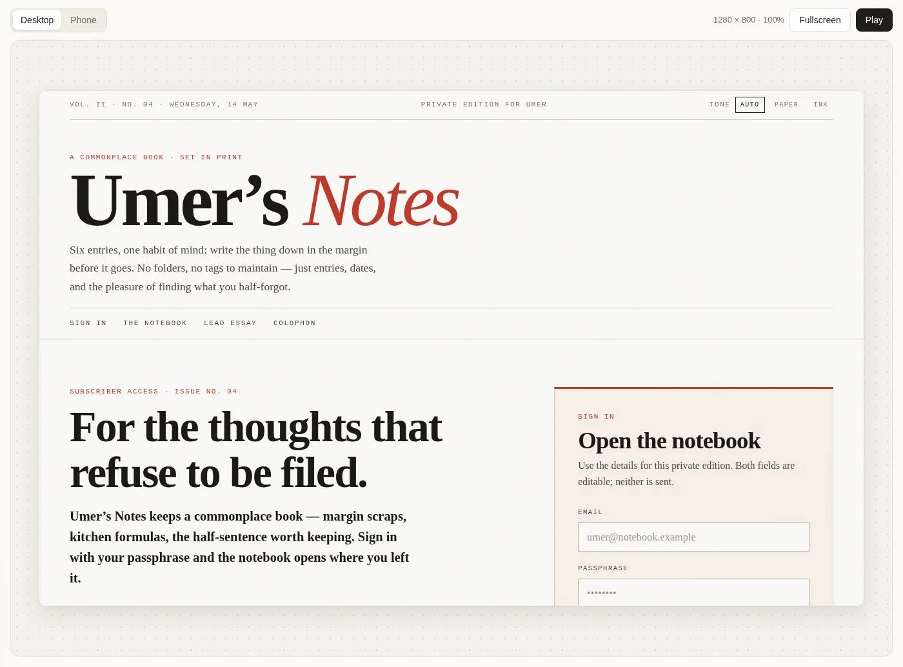
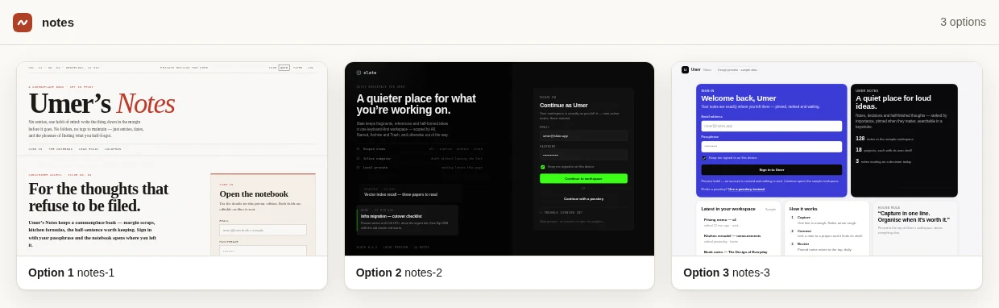
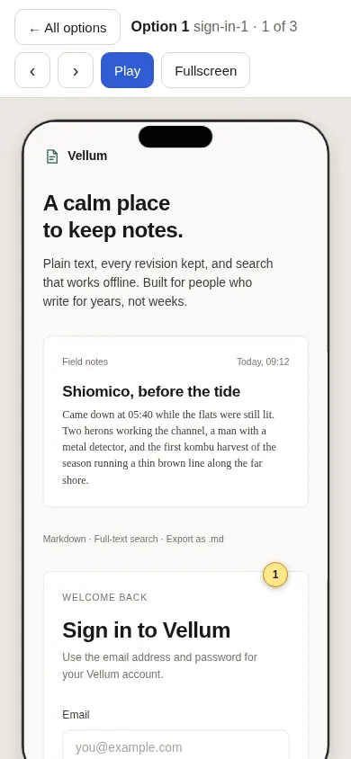

#  first-draft

**A CLI that turns one prompt into several HTML design options.**

For developers and coding agents: pick a design **before writing app code**.

[](https://umeranjum17.github.io/first-draft/)

### Start in three steps

Node **22.18+** and your own model subscription or API key. Three steps:

1. `npm install -g first-draft-axi`
2. `first-draft-axi init --agent byokit:codex --model YOUR_MODEL`
3. `first-draft-axi make "A notes app" --out notes.html && first-draft-axi view notes.html`

Replace `YOUR_MODEL` with a model your installed, signed-in Codex CLI supports. [Other routes ↓](#models) · Open the URL that `view` prints. Stop it with Ctrl+C.

[Landing page](https://umeranjum17.github.io/first-draft/) · [Agent skill](skills/first-draft-axi/SKILL.md), to hand the CLI to your coding agent · [CLI reference ↓](#reference)

## Choose a direction, not just a screenshot

- **Make options.** Add `--count 3` to the `make` command to get three directions. Each is a self-contained HTML file, not app code, and with no `--direction` each takes a different named style (`first-draft-axi styles` lists them).
- **Open one on the canvas.** Studio shows one option at a time at phone (390px) or desktop (1280px), switched with Phone and Desktop, beside its options, comments and a brief for your next change.
- **Look closer.** Fullscreen gives the option the whole window; Play is one tap away.
- **Refine the one you like.** A follow-up prompt writes a new option; your original stays untouched.





The screenshots come from one real run of `first-draft-axi make "A notes app for Umer with a sign-in screen and a notes dashboard" --count 3` (first-draft-axi 0.2.4, no `--direction`, so each option took a different named style), with no editing. Options 2 and 3 hit the engine's turn cap, and `make` said so: they hold the screens written so far. The large screenshot at the top is option 1. Generating needs your chosen model; viewing does not call it. These are prototypes, not production apps.

## Works alone, or with sign-off

First Draft needs nothing else: `make`, `view` and `refine` work on their own, and comments from people show as read-only pins on the canvas ([comment pins ↓](#reference)).

To get someone's pick, hand the options to [sign-off](https://github.com/umeranjum17/sign-off), a sibling review board. The board shows the options side by side; each one links into first-draft for the detail:

```sh
first-draft-axi post notes.html \
  --title "Which notes app?" \
  --recommend a
```

`post` copies the options into the board, starts `view` if it is not running, and posts one card with an **Open** link under each option. The link opens that option in Play in the viewer, and the card text repeats each one as "Open in first-draft". It needs `sign-off-axi` 0.5.0+ and a `.sign-off/` board in this folder or above (or `--board`). Links point at the viewer on its tailnet address, or at `--host`. Name options with `--option a=<label>`; demos that ask for no pick use `--evidence --media <shot>` instead of `--recommend`.

## Models

Every generation goes through [BYOKit](https://www.npmjs.com/package/@byokit/accounts), using the route and model **you** choose. First Draft never silently changes accounts or models.

| Use what you have | Route for `init --agent` |
| --- | --- |
| Installed, signed-in Codex CLI | `byokit:codex` |
| A plan key, such as Z.ai | `byokit:zai:plan_key` |
| An API key, such as MiniMax | `byokit:minimax:key` |

Run `first-draft-axi init` with no flags to list ready routes. Set your route with `init --agent … --model …`, then run `first-draft-axi doctor` to check readiness **without a paid call**. MiniMax defaults to `MiniMax-M3.1-Flash-Preview` if `init` gets no `--model`.

Subscription calls use your CLI's normal login without copying it. Key routes read the environment variable named by `doctor`; keys are never saved in First Draft's config. Config lives at `$FIRST_DRAFT_HOME/config.json`, default `~/.first-draft/config.json`.

## Reference

Run `first-draft-axi --help` for all flags. [ENGINE.md](ENGINE.md) covers the pinned engine and model boundary.

<details>
<summary><strong>Files, refinement and viewer routes</strong></summary>

`make --count N` accepts 1–5 options. `--out notes.html --count 3` writes `notes-1.html` through `notes-3.html`. Pass the original `notes.html` path to `view`; it finds those numbered options. You can also pass a folder or individual HTML files.

```sh
first-draft-axi refine \
  notes-2.html \
  "Warmer palette" \
  --out notes-warm.html
first-draft-axi view \
  notes-2.html notes-warm.html
```

`refine` uses the configured model and writes a new file. Keep the change short.

With Chrome or Chromium installed, `make` also renders each page at 390px, in light and in dark, and does not accept it until it fits with no sideways scroll and paints differently in dark (a dark-first style such as `oled-neon` must instead paint a dark page in both). `render_check` in the output says `checked` or `skipped`.

The viewer's grid links to each canvas at `#/o/<n>`; add `/phone` or `/desktop` to pick the device, `/full` for Fullscreen or `/play` for Play.

</details>

<details>
<summary><strong>Networking, sandboxing and comment pins</strong></summary>

`view` defaults to the machine's tailnet address (`tailscale ip -4`), port 4430. Use `--host` and `--port` to change it; `--host 127.0.0.1` keeps the viewer on this machine. Option frames use the next port, a separate origin.

Generated files carry no scripts and their own content security policy. The viewer adds a sandboxed runtime for screen navigation, but options load and send nothing over the network. Remote assets named by a design are listed as `blocked_remote` and show empty.

Comment pins are read-only. Put `notes.comments.json` next to `notes.html`, with an array such as `[{"option":1,"x":0.4,"y":0.2,"text":"More space here"}]`. Coordinates are fractions of the frame. Tap a numbered pin to read it. No file means no pins; an invalid file produces a notice.

</details>

## Develop

```sh
npm install
npm test
```

Tests build and exercise the engine loop against local stand-ins, with no paid model call. A command, default or viewer change updates this README, the agent skill and the screenshots together.

MIT · [License](LICENSE) · [Notice](NOTICE): the design engine is [Open CoDesign](https://github.com/OpenCoworkAI/open-codesign), MIT
