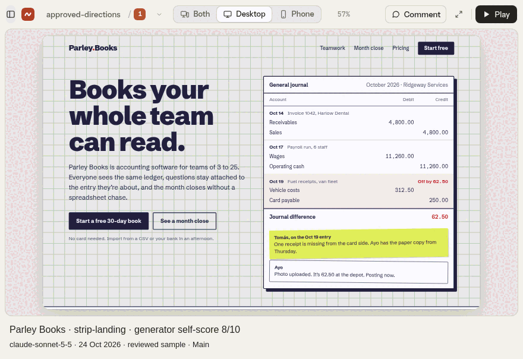
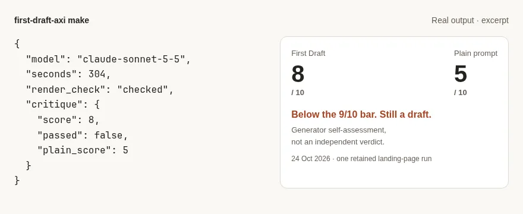
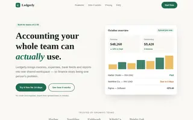
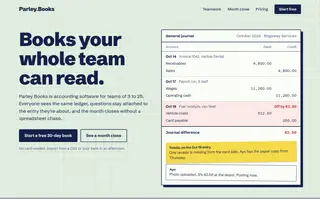
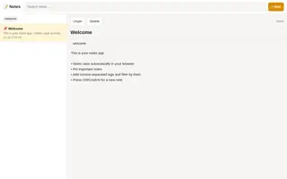
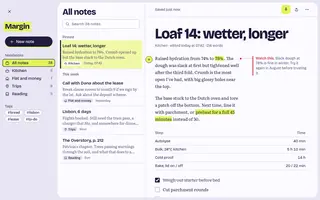

<div align="center">

#  first-draft

**Pick a design direction before writing app code.**

For developers and coding agents: explore HTML options using your own AI subscription.

<picture>
  <source media="(max-width: 600px) and (prefers-color-scheme: dark)" srcset="docs/media/reviewed-pair-phone-dark.gif">
  <source media="(max-width: 600px)" srcset="docs/media/reviewed-pair-phone.gif">
  <source media="(prefers-color-scheme: dark)" srcset="docs/media/reviewed-pair-dark.gif">
  
</picture>

<sub>Two real retained options in the Studio, unaltered: **Parley Books**, generator self-scored **8/10**, and **Margin**, **7/10** — `claude-sonnet-5-5`, runs `strip-landing` and `strip2-notes`, 24 October 2026. Self-scores, below our 9/10 bar: a [reviewed sample](docs/quality.md#the-readme-hero--24-october-2026), not a quality claim.</sub>

[Website](https://umeranjum17.github.io/first-draft/) · [Quick start](#quick-start) · [Docs](docs/guide.md) · [Agent skill](skills/first-draft-axi/SKILL.md)

[](https://www.npmjs.com/package/first-draft-axi) [](https://github.com/umeranjum17/first-draft/actions/workflows/ci.yml) [](LICENSE) [](https://x.com/umership)

</div>

## Quick start

```sh
npm install -g first-draft-axi
first-draft-axi init \
  --agent byokit:codex \
  --model gpt-6.1-sol
first-draft-axi make "A notes app" \
  --out notes.html && \
  first-draft-axi view notes.html
```

Requires Node **22.18+**, Chrome/Chromium, a usable AI generator and an independent signed-in subscription judge on a different engine (normally Claude plus Codex). Saved configuration is optional: first-draft resolves ready installed logins and supported BYOKit key routes, then names the chosen generator and judge in the run JSON. Without a usable engine it exits with one exact sign-in command, before generating pages. Open the URL `view` prints; Ctrl+C stops it. Generation uses your subscription quota; viewing makes no model calls.

Prefer Claude? Use `--agent byokit:claude --model claude-sonnet-5-5` in step 2 with your signed-in Claude CLI. `first-draft-axi doctor` checks readiness without a model call and names the resolved engine. [Other routes](#models).

## Why first-draft?

| Instead of… | You get… |
| --- | --- |
| Committing to the first page a model returns | Three design directions by default; choose one to refine |
| Describing a layout only in chat | Self-contained HTML you can open at desktop and phone width |
| Losing the original when you ask for changes | A new option; the original file stays untouched |
| Treating a model's first answer as finished | Render checks and a critic comparison against a plain-prompt page; low scores stay flagged |

## Make, compare, refine

*The hero is a native capture of the Studio with two retained options; [how it was captured](docs/ui/README.md).*

- **Explore more than one direction.** Ask for 1–5 options, a named style, or a multi-screen flow.
- **Compare at the right size.** Studio has Desktop, Phone and Both views; Play opens a screen flow.
- **Point at the change.** Click a spot to leave a comment; numbered pins and plain JSON keep the feedback beside the design.
- **See the market first.** `--competitors` finds 3–5 real products of the brief's kind, captures their public pages through the same robots/terms review as a reference, and shows them beside the options with their sources and every refusal.
- **Keep the original.** Refine into a new option, or send the choices to [sign-off](https://github.com/umeranjum17/sign-off) for someone's pick.

`first-draft-axi init` also installs the [agent skill](skills/first-draft-axi/SKILL.md) for Claude Code, Codex and pi in your repo. Commands return JSON, so your coding agent can drive the same workflow.

## Proof, not a promise of perfect design

<picture>
  <source media="(max-width: 600px) and (prefers-color-scheme: dark)" srcset="docs/ui/make-phone-dark.webp">
  <source media="(max-width: 600px)" srcset="docs/ui/make-phone-light.webp">
  <source media="(prefers-color-scheme: dark)" srcset="docs/ui/make-dark.webp">
  
</picture>

This is a **formatted excerpt of real CLI output** from a different run, not a generated page or an interactive critic screen: **Claude Sonnet 5.5, 24 October 2026**, 304 seconds, self-scored **8/10 versus 5/10** for its plain-prompt baseline. It failed the 9/10 quality bar. A generator rating itself is not independent evidence of quality.

Same brief, same model (Claude Sonnet 5.5), 24 October 2026 — First Draft on the right:

**a landing page for a small accounting software company** — First Draft wins, 8 to 6.5

| Plain prompt | First Draft ✅ |
| --- | --- |
| <h2>6.5 <sub>/ 10</sub></h2> | <h2>8 <sub>/ 10</sub></h2> |

**a notes app** — First Draft wins, 7.5 to 3

| Plain prompt | First Draft ✅ |
| --- | --- |
| <h2>3 <sub>/ 10</sub></h2> | <h2>7.5 <sub>/ 10</sub></h2> |

One run per cell, scored by the review worker, not customers and not an independent judge; before our fixes First Draft scored **4** on both of these. **[How good is it?](docs/quality.md)** has all four briefs side by side, the method, the limits, what we fixed and the rerun command.

- [Published npm releases](https://www.npmjs.com/package/first-draft-axi?activeTab=versions): the clean install path was checked with the packed **0.5.0** build; the release workflow publishes after merge.
- [CI](https://github.com/umeranjum17/first-draft/actions/workflows/ci.yml): builds and drives CLI/browser checks with local provider stand-ins, without paid generation. The **25 October 2026** local run passed **74 tests, zero failures, zero skips**.
- [Comparison contract](CONTRIBUTING.md): wrapper additions need paired rendered evidence; our own tool must not quietly lower the plain model's output bar.

## Models

| What you already have | `init --agent` |
| --- | --- |
| Signed-in Codex CLI / ChatGPT subscription | `byokit:codex` |
| Signed-in Claude CLI / Claude subscription | `byokit:claude` |
| A plan key, such as Z.ai | `byokit:zai:plan_key` |
| An API key, such as MiniMax | `byokit:minimax:key` |

Calls use [BYOKit](https://www.npmjs.com/package/@byokit/accounts). An authenticated saved preference is tried first, then other ready supported sources. Account pools may rotate accounts only on the resolved engine/model; a cross-engine pick is refused. Native OpenCode login storage is detected but cannot yet be executed by this build's BYOKit; supported OpenCode key accounts work. Subscription routes use your normal CLI login, without copying credentials. [Configuration and provider details](docs/guide.md#models).

## Known limits

Options are prototypes, not production apps. Model assessments can be wrong; independently judge designs and verify claims before shipping. Render checks need Chrome/Chromium. Generated assets are opt-in, separately approved spending; add `--hero-video` (or name Higgsfield) to a `--assets` run and the hero image also becomes a short looping hero video under the same approval. Public-URL redesign supports anonymous, script-disabled HTML, not signed-in apps or SPA flows.

## Reference

[Testing guide](docs/TESTING.md) · [All flags and viewer routes](docs/guide.md#reference) · [Redesign an existing site](docs/guide.md#redesign-an-existing-product-first-slice) · [Assets](docs/guide.md#generated-assets) · [Logos](docs/guide.md#logos) · [References and judge](docs/guide.md#independent-judge-and-reference-cache) · [Competitor search](docs/guide.md#what-the-market-does-competitors) · [Free inspiration sources](docs/inspiration.md) · [Engine](ENGINE.md)

## Contributing

```sh
npm ci
npm test
```

See [CONTRIBUTING.md](CONTRIBUTING.md) for the paired-comparison quality bar.

MIT · [License](LICENSE) · [Notice](NOTICE) · Design engine: [OpenDesign](https://github.com/umeranjum17/open-design) (Apache-2.0; [pin and attribution](ENGINE.md))
